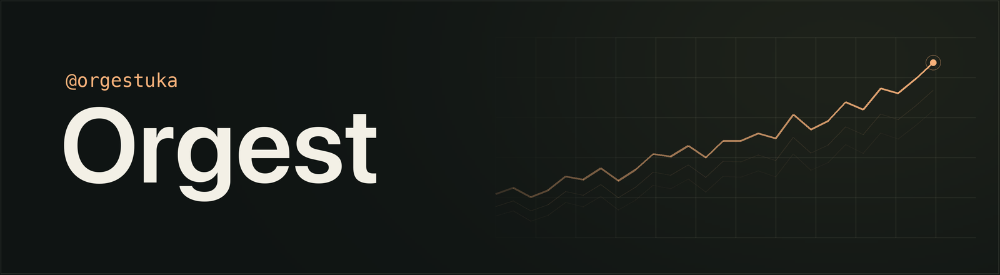

I build native Mac apps and developer tools. I work on market research and trading software at [ValorAlgo](https://valoralgo.com) and [ValorTraders](https://valortraders.com).

## Selected work

- **Relay** is a WebMCP demo for coordinating shelter, transport, and supplies with human approval. [Relay on GitHub](https://github.com/orgestuka/relay-webmcp)
- **Context Watch** keeps a live map of your project’s file tree for Cursor. [Context Watch on GitHub](https://github.com/orgestuka/cursor-context-watch)
- **CompressImage** compresses images and converts them to WebP. [CompressImage on GitHub](https://github.com/orgestuka/CompressImage)
